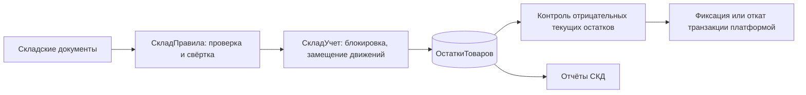

# Складской учёт на 1С

[](https://github.com/Foam0/onec-warehouse/actions/workflows/ci.yml)

Учебная конфигурация для небольшого склада и магазина. Поступления увеличивают остатки,
расходы списывают товар, перемещения меняют склад хранения. Отрицательные текущие остатки запрещены,
включая изменения и отмену уже проведённых документов.

**Статус:** исходники для Конфигуратора 1С:Предприятия 8.3; 15 проверок исходного BSL-модуля
исполнены через OneScript. Загрузка XML, компиляция и интеграционные сценарии на платформе 1С
ещё не проверены. OneScript проверяет общие алгоритмы, но не эмулирует регистры и транзакции 1С.

## Что реализовано

- Справочники «Номенклатура» и «Склады»; минимальный запас для каждой позиции.
- Документы «Поступление товаров», «Расход товаров», «Перемещение товаров».
- Регистр накопления «Остатки товаров»: измерения склад/номенклатура, ресурс количество.
- Свёртка одинаковых товаров перед записью движений; проверка положительных количеств.
- Замещение движений при перепроведении; проверка текущих остатков после записи.
- Управляемая исключительная блокировка на время изменения остатков.
- Запрет отмены использованного поступления и удаления проведённого документа.
- Отчёты на СКД «Остатки по складам» и «Товары к закупке».
- Обработка с созданием демоданных и запуском интеграционных сценариев.

## Пример

| Операция | Основной склад | Магазин |
|---|---:|---:|
| Поступление 20 кабелей | 20 | 0 |
| Расход 6 кабелей | 14 | 0 |
| Перемещение 4 кабелей в магазин | 10 | 4 |
| Повторное проведение расхода | 10 | 4 |
| Попытка списать ещё 12 с основного склада | отказ | 4 |

Если расход содержит две строки одного товара по 6 штук, при остатке 10 он тоже отклоняется.
Отмена исходного поступления после расхода отклоняется в той же транзакции.

## Архитектура



Основные файлы:

- [СкладПравила](src/CommonModules/СкладПравила/Ext/Module.bsl): чистые алгоритмы без базы данных.
- [СкладУчет](src/CommonModules/СкладУчет/Ext/Module.bsl): проведение, блокировка и запросы к регистру.
- [Интеграционные сценарии](src/CommonModules/СкладИнтеграционныеТесты/Ext/Module.bsl).
- [Тесты общих правил](tests/run.os): загружают настоящий BSL-модуль, без копирования его реализации.

Блокировка всего регистра намеренно упрощает учебный пример: она покрывает и старые измерения
при изменении складов/товаров в проведённом документе. Для большой базы нужны блокировки по ключам,
с учётом объединения старых и новых измерений и единого порядка их захвата.

## Загрузка в 1С

Целевая среда: 1С:Предприятие 8.3.23+ с управляемым приложением. Конкретная версия платформы
не была проверена; настройка режима совместимости — 8.3.17. Типовые конфигурации и БСП не нужны.

1. Создайте **новую пустую учебную информационную базу**.
2. Откройте Конфигуратор: **Конфигурация → Загрузить конфигурацию из файлов**; выберите каталог `src`.
3. Выполните проверку конфигурации для тонкого клиента, сервера и внешнего соединения.
4. Обновите конфигурацию базы данных.
5. Создайте пользователя `Администратор` с ролью `ПолныеПрава` и языком `Русский`.
6. Запустите 1С:Предприятие под этим пользователем.
7. В разделе «Рабочее место» откройте обработку «Демонстрация».

Для Windows есть [скрипт сборки](scripts/build.ps1), который отказывается использовать существующую папку базы:

```powershell
.\scripts\build.ps1 -Platform "C:\Program Files\1cv8\8.3.XX.YYYY\bin\1cv8.exe"
```

Версию и путь замените на установленные у вас. Проверьте логи в `build/`; нулевой код завершения
процесса не заменяет просмотр результата проверки конфигурации.

## Демонстрация и проверки

В чистой базе сначала нажмите **ПроверитьСценарии**: успешные и ошибочные тестовые операции
откатываются. Затем нажмите **ЗаполнитьДемо**: получите два склада, один товар и три проведённых документа.
Повторное заполнение отклоняется, чтобы не создавать дополнительные остатки.

Откройте отчёты и сформируйте остатки. Для проверки дефицита создайте расход с основного склада
на 12 кабелей; ожидается сообщение о недостаточном количестве. Для проверки перепроведения
измените исходный расход с 6 на 5: остаток основного склада должен стать 11.

Без платформы 1С:

```bash
python3 scripts/check_metadata.py
oscript tests/run.os
```

Для локальной статической проверки нужен [BSL Language Server 1.0.7](https://github.com/1c-syntax/bsl-language-server/releases/tag/v1.0.7)
и Java 21+. Точные команды автоматизированы в [CI](.github/workflows/ci.yml).
Результаты и пределы проверок: [docs/verification.md](docs/verification.md).

## Границы проекта

Учёт количественный: нет себестоимости, партий, резервов, НДС, бухгалтерских проводок и обмена данными.
Контролируются **текущие**, а не исторические остатки; документы задним числом разрешены и могут менять
прошлую картину запасов. Будущее проведение запрещено. Минимальный запас рассчитывается по сумме
всех складов. Это учебная база с административной ролью, без разграничения доступа кладовщиков.
Нагрузочные и конкурентные проверки в двух сеансах не выполнены.

## Для резюме

> Учебный проект «Складской учёт» на 1С:Предприятии 8.3: документы поступления, расхода и перемещения,
> регистр накопления остатков, контроль дефицита, перепроведение, управляемые блокировки и отчёты СКД.
> Общие правила проверены 15 автоматизированными тестами на OneScript; исходники и CI доступны на GitHub.

Материал для подготовки к обсуждению проекта: [docs/interview.md](docs/interview.md).

## Источники и лицензия

Бизнес-код и сценарии написаны для этого проекта. XML-каркасы метаданных адаптированы из
проверочных конфигураций `1c-syntax`; происхождение и изменения перечислены в [NOTICE.md](NOTICE.md).
Лицензия проекта — LGPL-3.0-or-later, см. [LICENSE](LICENSE) и [COPYING](COPYING).

Механизмы платформы: [движения документов](https://1c-dn.com/library/tutorials/practical_developer_guide_creating_register_records_of_document/),
[регистры накопления](https://1c-dn.com/library/tutorials/practical_developer_guide_understanding_accumulation_registers/practical_developer_guide_accumulation_registers.htm).
